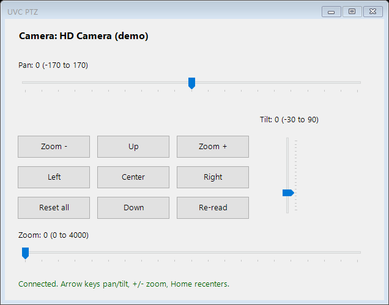

# uvc-ptz-win

Pan / tilt / zoom control for **USB (UVC) PTZ cameras on Windows**, in one PowerShell file. No driver, vendor app, module or install: it talks to the camera through DirectShow `IAMCameraControl`, the interface behind the "Camera Control" tab of a webcam's property page.



Windows has no built-in UI for this. Most UVC PTZ cameras (conference cameras, USB PTZ webcams) ship either a large vendor suite or nothing at all; Zoom and Teams only expose PTZ for certified models.

## Use

Double-click **`uvc-ptz.cmd`**, or from a terminal:

```powershell
.\uvc-ptz.ps1                       # first camera that can pan, tilt or zoom
.\uvc-ptz.ps1 -Device "HD Camera"   # pick a camera by (part of) its name
```

- Sliders and buttons move the camera; values are clamped to the camera's range and step.
- Keyboard: arrow keys pan and tilt, `+` / `-` zoom, `Home` recenters pan and tilt.
- **Center** sets pan and tilt to the camera's default; **Reset all** includes zoom.
- **Re-read** reloads the position, for example after another app moved the camera.

### Scripting

```powershell
.\uvc-ptz.ps1 -List
# <camera name>
#   Pan      min=... max=... step=... default=... caps=...
#   Tilt     min=... max=... step=... default=... caps=...
#   Zoom     min=... max=... step=... default=... caps=...
#   not supported: Roll, Exposure, Iris

.\uvc-ptz.ps1 -Set Pan=0,Tilt=10,Zoom=100
# <camera name> Pan=0
# <camera name> Tilt=10
# <camera name> Zoom=100
```

Ranges and units come from the camera driver; pan and tilt are usually degrees.

`-Set` accepts any `IAMCameraControl` property: `Pan`, `Tilt`, `Roll`, `Zoom`, `Exposure`, `Iris`, `Focus`. It prints the value the camera reports after the change. Use it for presets on a hotkey or a Stream Deck button.

## Requirements

- Windows 10 or 11
- Windows PowerShell 5.1 (built in) or PowerShell 7
- A camera that exposes pan, tilt or zoom over UVC. Run `-List` to check: a camera that shows `camera control: not supported`, or no Pan/Tilt/Zoom lines, cannot be moved this way. Some cameras only move with their vendor's own protocol.

If another app has the camera open, control usually still works; video apps generally keep the device open but leave camera control free.

## How it works

The script compiles a small C# class with `Add-Type` that:

1. enumerates video input devices with `ICreateDevEnum` (`CLSID_VideoInputDeviceCategory`);
2. reads each device's `FriendlyName` from its `IPropertyBag`;
3. binds the device filter and queries `IAMCameraControl`;
4. uses `GetRange` / `Get` / `Set` (with `CameraControl_Flags_Manual`) for each property.

All COM objects are released when the window closes.

## Status

Written for a Hikvision USB PTZ camera and used with it. The screenshot above is a render with a stand-in device and made-up ranges, because no camera was attached when it was taken. The `-List` and `-Set` paths compile and parse cleanly on Windows PowerShell 5.1; please report results from other cameras, with your `-List` output.

## License

[MIT](LICENSE)
